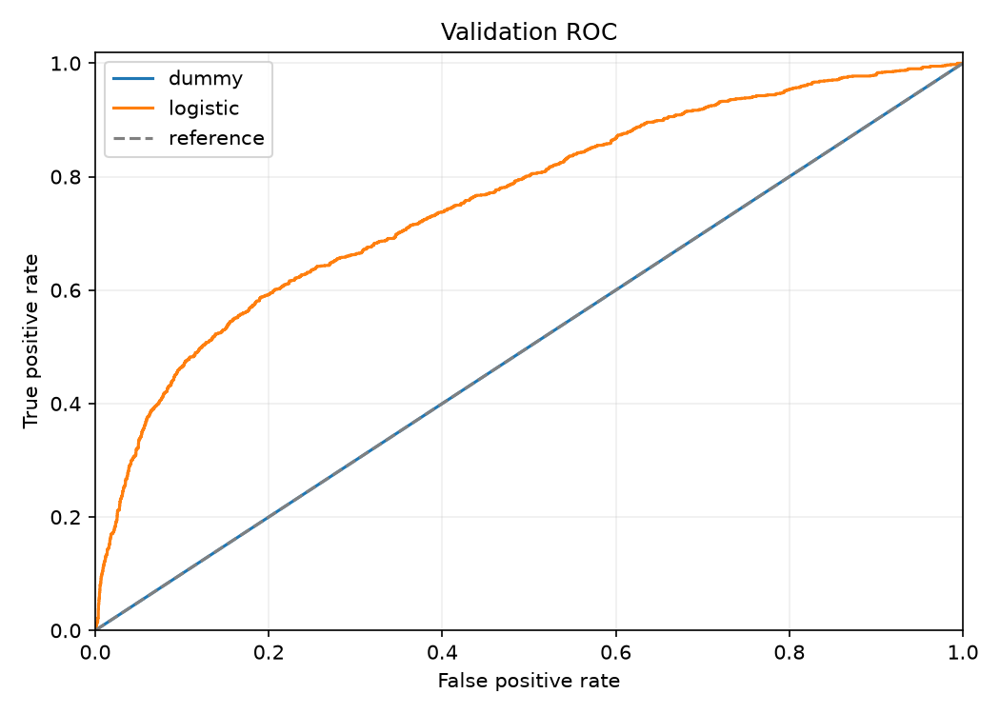
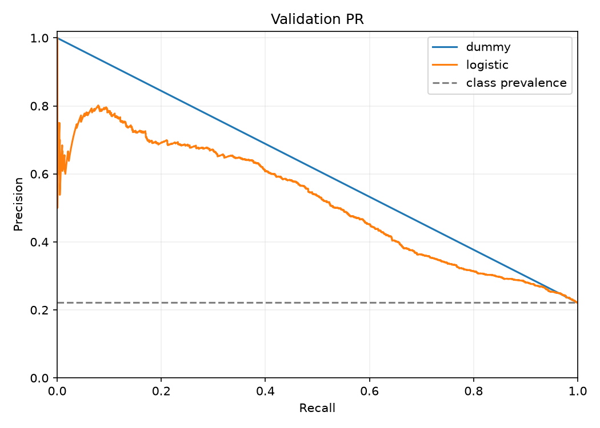
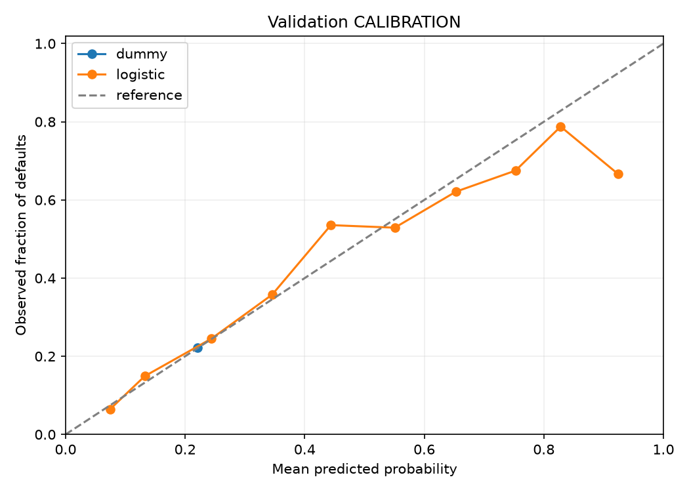

# Stage 4: baseline models (train / validation)

Train: 18,000 clients. Validation: 6,000. 
Reserved test: 6,000; not evaluated.

Dummy uses training prevalence; logistic regression uses fixed L2 regularization (C=1.0).
Categorical codes are retained as categories; numeric medians, most-frequent category imputation,
one-hot vocabularies and standardization are fitted only on train. Unknown categories are ignored.
No class rebalancing, tuning or test scoring is performed.

## Metrics

| Model | Partition / threshold | Threshold | ROC-AUC | AP | Precision | Recall | F1 | Brier | TN | FP | FN | TP |
|---|---|---:|---:|---:|---:|---:|---:|---:|---:|---:|---:|---:|
| dummy | train_at_0_5 | 0.500000 | 0.500000 | 0.221222 | 0.000000 | 0.000000 | 0.000000 | 0.172283 | 14018 | 0 | 3982 | 0 |
| dummy | validation_at_0_5 | 0.500000 | 0.500000 | 0.221167 | 0.000000 | 0.000000 | 0.000000 | 0.172252 | 4673 | 0 | 1327 | 0 |
| dummy | validation_at_selected_threshold | 0.221222 | 0.500000 | 0.221167 | 0.221167 | 1.000000 | 0.362222 | 0.172252 | 0 | 4673 | 0 | 1327 |
| logistic | train_at_0_5 | 0.500000 | 0.776866 | 0.560822 | 0.692235 | 0.369412 | 0.481742 | 0.133543 | 13364 | 654 | 2511 | 1471 |
| logistic | validation_at_0_5 | 0.500000 | 0.756748 | 0.516231 | 0.649096 | 0.324793 | 0.432948 | 0.140236 | 4440 | 233 | 896 | 431 |
| logistic | validation_at_selected_threshold | 0.257804 | 0.756748 | 0.516231 | 0.498965 | 0.544838 | 0.520893 | 0.140236 | 3947 | 726 | 604 | 723 |

## Validation observations

- Logistic ROC-AUC: better than Dummy on validation (difference +0.256748).
- Logistic AP: better than Dummy on validation (difference +0.295064).
- Logistic Brier: better than Dummy on validation (difference -0.032016).
- Thresholds maximize F1 on validation independently per model, with highest-threshold tie breaking.
- Selected-threshold validation scores are selection-dependent, not independent test estimates.
- ROC-AUC and AP assess ranking, Brier assesses probability error (lower is better).
- A constant Dummy score may predict every client positive at its F1-selected threshold.

## Largest absolute logistic coefficients

| Transformed feature | Coefficient |
|---|---:|
| categorical__repayment_status_m6_0 | -1.092644 |
| categorical__max_repayment_status_-2 | -0.883524 |
| categorical__marriage_0 | -0.849565 |
| categorical__repayment_status_m5_4 | -0.848359 |
| categorical__repayment_status_m6_3 | 0.815378 |
| categorical__repayment_status_m3_5 | -0.794633 |
| categorical__education_5 | -0.714098 |
| categorical__education_4 | -0.674947 |
| categorical__repayment_status_m6_-2 | -0.667303 |
| categorical__repayment_status_m6_2 | 0.655096 |

Coefficients describe model associations on the transformed scale, not causal effects.
Correlated engineered features and redundant one-hot levels limit isolated interpretations.
Demographic variables may raise fairness concerns; this historical dataset is not suitable for real lending decisions.

## Validation figures

The calibration curve is descriptive; no calibration model is fitted. Test remains untouched for stage 5.
