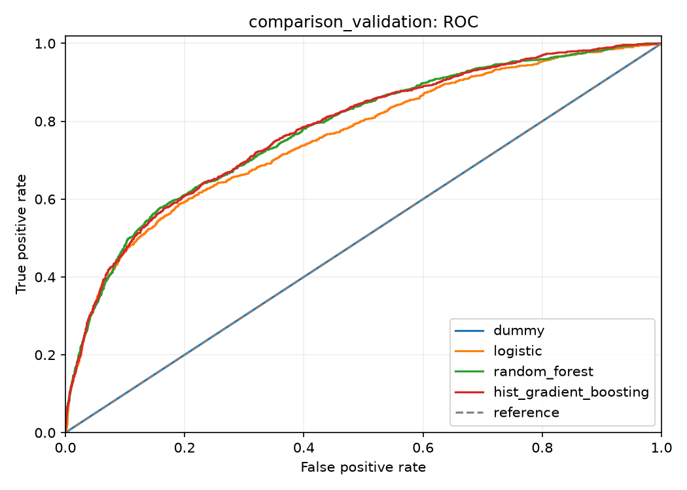
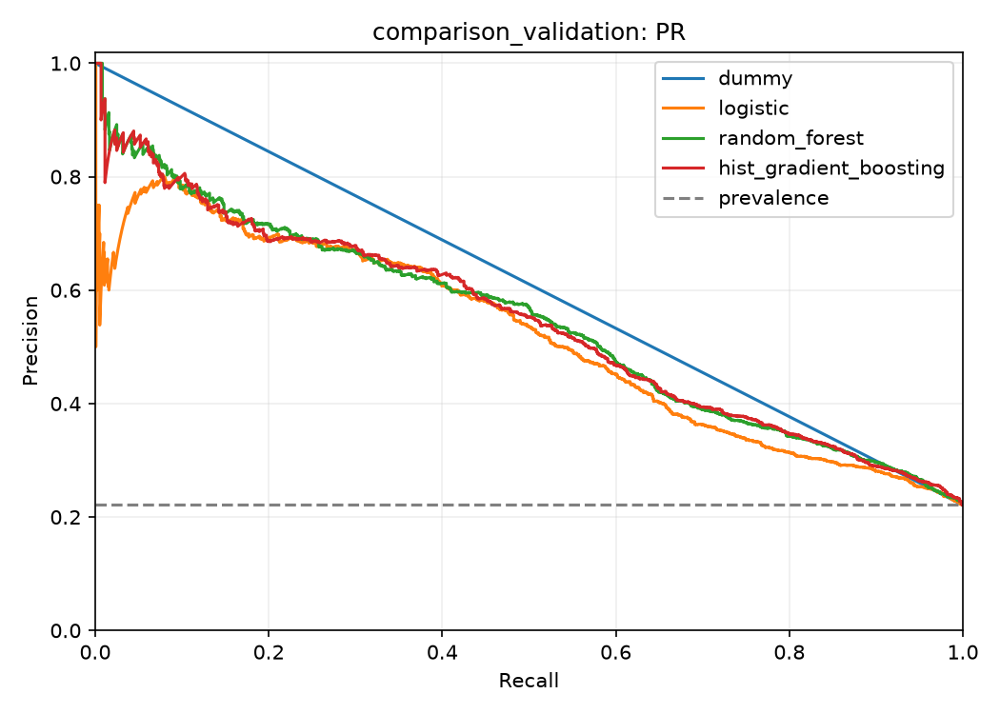
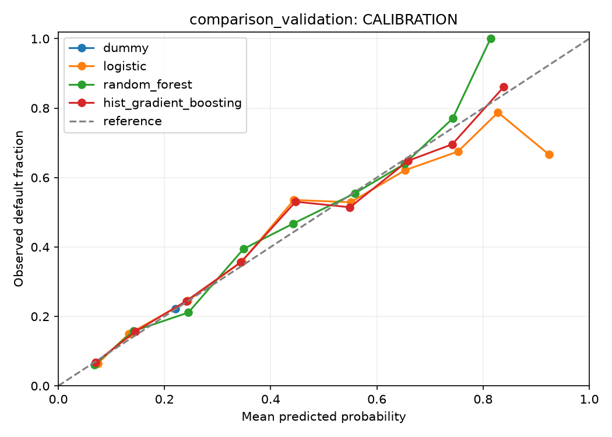

# Stage 5: model comparison (validation)

Train: 18,000; validation: 6,000; reserved test: 6,000 (not scored).

Preprocessing is fitted inside each training fold. Three stratified folds, seed 42; search maximizes mean CV ROC-AUC. Winning hyperparameters are refitted on train only.

## Validation comparison

| Model | Threshold | ROC-AUC | AP | Precision | Recall | F1 | Brier | TN | FP | FN | TP |
|---|---:|---:|---:|---:|---:|---:|---:|---:|---:|---:|---:|
| dummy | 0.221222 | 0.500000 | 0.221167 | 0.221167 | 1.000000 | 0.362222 | 0.172252 | 0 | 4673 | 0 | 1327 |
| logistic | 0.257804 | 0.756748 | 0.516231 | 0.498965 | 0.544838 | 0.520893 | 0.140236 | 3947 | 726 | 604 | 723 |
| random_forest | 0.271945 | 0.776269 | 0.542365 | 0.508632 | 0.577242 | 0.540770 | 0.137246 | 3933 | 740 | 561 | 766 |
| hist_gradient_boosting | 0.261017 | 0.777227 | 0.541335 | 0.509576 | 0.561417 | 0.534242 | 0.137266 | 3956 | 717 | 582 | 745 |

Selection rule: Highest validation ROC-AUC, then AP, then lower Brier, then fixed candidate order.
Selected model: **hist_gradient_boosting**; threshold: **0.26101717**.
Thresholds maximize validation F1; test is not used for selection. Dummy is a reference only.

## Train-only CV

### random_forest

Best parameters: `{"model__max_depth": null, "model__min_samples_leaf": 20}`; mean CV ROC-AUC: 0.783372.

| Parameters | Mean ROC-AUC | Fold SD |
|---|---:|---:|
| `{"model__max_depth": 8, "model__min_samples_leaf": 5}` | 0.780532 | 0.006419 |
| `{"model__max_depth": 8, "model__min_samples_leaf": 20}` | 0.780979 | 0.006498 |
| `{"model__max_depth": null, "model__min_samples_leaf": 5}` | 0.778683 | 0.007181 |
| `{"model__max_depth": null, "model__min_samples_leaf": 20}` | 0.783372 | 0.006259 |

### hist_gradient_boosting

Best parameters: `{"model__learning_rate": 0.05, "model__max_leaf_nodes": 15}`; mean CV ROC-AUC: 0.783924.

| Parameters | Mean ROC-AUC | Fold SD |
|---|---:|---:|
| `{"model__learning_rate": 0.05, "model__max_leaf_nodes": 15}` | 0.783924 | 0.007559 |
| `{"model__learning_rate": 0.05, "model__max_leaf_nodes": 31}` | 0.783774 | 0.009250 |
| `{"model__learning_rate": 0.1, "model__max_leaf_nodes": 15}` | 0.782692 | 0.008820 |
| `{"model__learning_rate": 0.1, "model__max_leaf_nodes": 31}` | 0.776173 | 0.011321 |

Selected minus logistic validation ROC-AUC: +0.020479. No improvement is assumed.

## Validation permutation importance (top 10)

| Feature | Mean AUC decrease | SD |
|---|---:|---:|
| delinquent_month_count | 0.125835 | 0.002861 |
| limit_bal | 0.017955 | 0.001851 |
| repayment_status_m6 | 0.016946 | 0.001415 |
| avg_payment_amount | 0.008109 | 0.000450 |
| payment_amount_m4 | 0.005147 | 0.000548 |
| payment_amount_m5 | 0.004228 | 0.000660 |
| bill_amount_m6 | 0.004198 | 0.000429 |
| bill_amount_m5 | 0.003680 | 0.000177 |
| payment_to_abs_bill_ratio | 0.003563 | 0.000153 |
| bill_amount_change_6m | 0.002925 | 0.000812 |

Three permutations per raw input feature. Correlated features can share importance; this is not a causal analysis. Validation scores are selection-dependent, not final estimates.

Calibration curves are descriptive; no probability calibration is fitted.
The historical dataset and demographic variables limit real-world use. Not for lending decisions.

