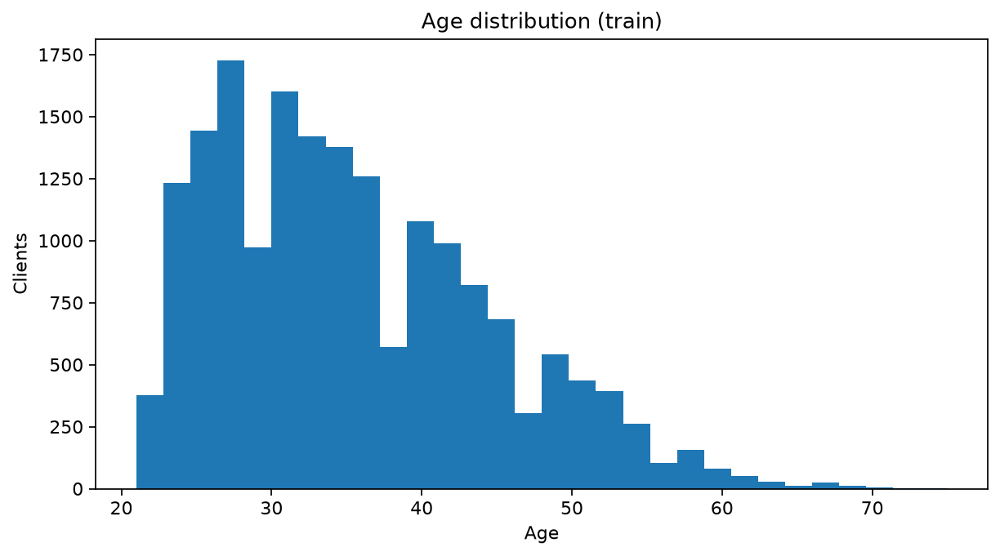
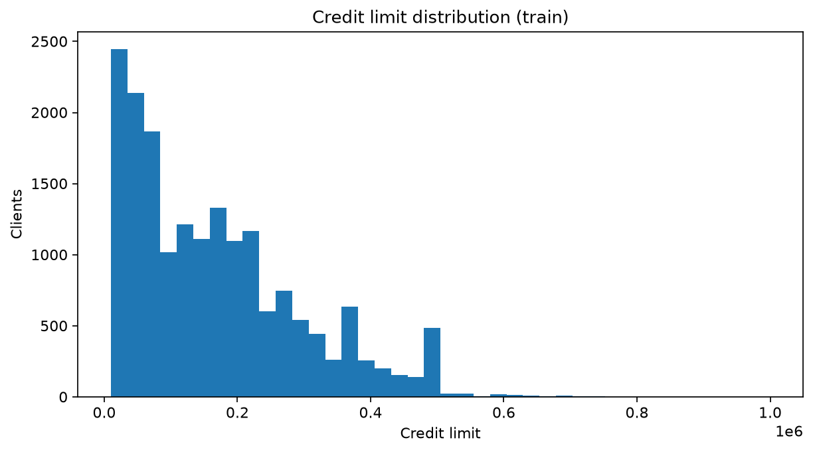
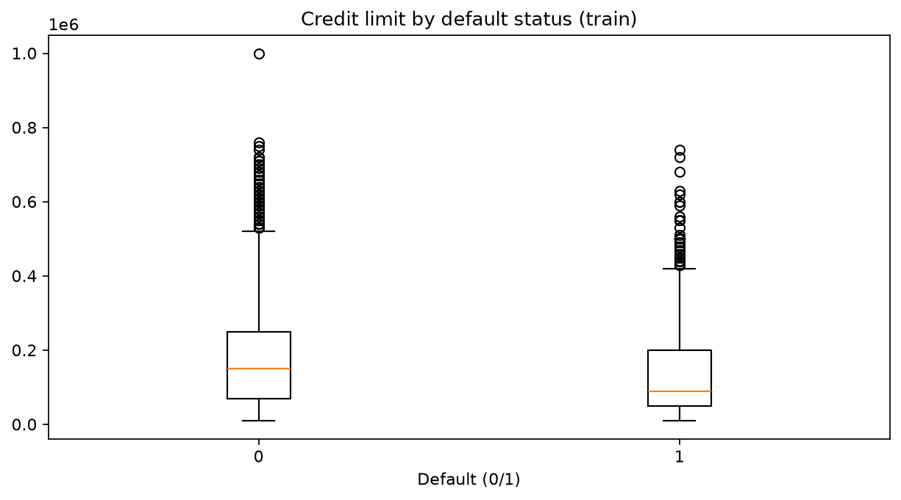
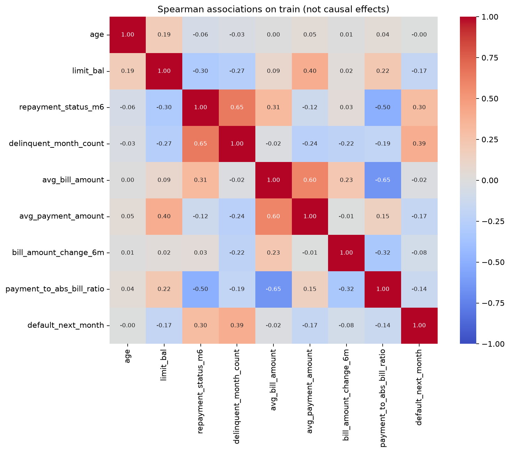
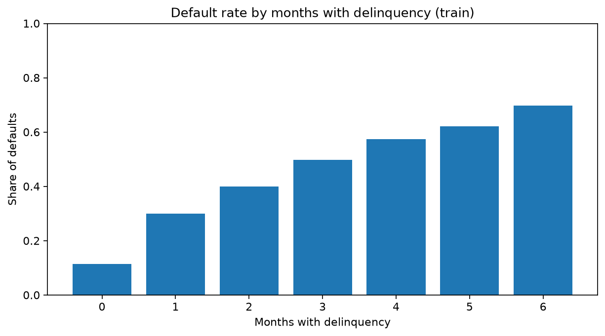

# Exploratory Data Analysis: train only

**Dataset:** UCI Default of Credit Card Clients (ID 350).
**Scope:** train partition only. Validation and test are not inspected by this report.

- Train clients: **18,000**
- Feature columns: **30**
- Non-default (0): **14,018**
- Default (1): **3,982**
- Default share: **22.12%**

## Numeric descriptive statistics

Sample variance and sample standard deviation use ddof=1. IQR outliers are flagged, not removed.

| Feature | N finite | Missing/nonfinite | Mean | Median | Q25 | Q75 | Variance | Std. dev. | IQR outliers |
|---|---:|---:|---:|---:|---:|---:|---:|---:|---:|
| `age` | 18000 | 0 | 35.422 | 34.000 | 28.000 | 41.000 | 83.830 | 9.156 | 145 |
| `limit_bal` | 18000 | 0 | 167,730.667 | 140,000.000 | 50,000.000 | 240,000.000 | 16,839,642,995.278 | 129,767.650 | 101 |
| `bill_amount_m1` | 18000 | 0 | 39,040.361 | 17,143.000 | 1,214.000 | 49,341.750 | 3,562,297,531.699 | 59,684.986 | 1627 |
| `bill_amount_m2` | 18000 | 0 | 40,562.436 | 18,165.500 | 1,755.000 | 50,493.500 | 3,733,535,482.301 | 61,102.663 | 1660 |
| `bill_amount_m3` | 18000 | 0 | 43,623.105 | 18,991.000 | 2,400.000 | 55,388.000 | 4,192,202,805.918 | 64,747.222 | 1573 |
| `bill_amount_m4` | 18000 | 0 | 47,318.356 | 20,074.000 | 2,720.000 | 60,420.000 | 4,770,243,587.538 | 69,066.950 | 1516 |
| `bill_amount_m5` | 18000 | 0 | 49,538.128 | 21,226.500 | 3,049.500 | 64,552.000 | 5,133,158,558.649 | 71,646.065 | 1435 |
| `bill_amount_m6` | 18000 | 0 | 51,473.410 | 22,344.500 | 3,594.000 | 67,571.000 | 5,469,565,475.296 | 73,956.511 | 1446 |
| `payment_amount_m1` | 18000 | 0 | 5,280.175 | 1,500.000 | 106.750 | 4,000.000 | 322,938,513.023 | 17,970.490 | 1773 |
| `payment_amount_m2` | 18000 | 0 | 4,808.269 | 1,526.000 | 242.500 | 4,057.000 | 229,538,829.049 | 15,150.539 | 1768 |
| `payment_amount_m3` | 18000 | 0 | 4,839.540 | 1,500.000 | 300.000 | 4,100.000 | 230,485,547.026 | 15,181.750 | 1809 |
| `payment_amount_m4` | 18000 | 0 | 5,288.638 | 1,854.000 | 390.000 | 4,600.000 | 343,378,954.502 | 18,530.487 | 1568 |
| `payment_amount_m5` | 18000 | 0 | 5,940.287 | 2,021.000 | 862.000 | 5,000.000 | 454,165,717.819 | 21,311.164 | 1663 |
| `payment_amount_m6` | 18000 | 0 | 5,685.199 | 2,138.500 | 1,000.000 | 5,045.750 | 285,553,949.682 | 16,898.342 | 1608 |
| `max_repayment_status` | 18000 | 0 | 0.443 | 0.000 | 0.000 | 2.000 | 1.809 | 1.345 | 66 |
| `delinquent_month_count` | 18000 | 0 | 0.842 | 0.000 | 0.000 | 1.000 | 2.427 | 1.558 | 2274 |
| `avg_bill_amount` | 18000 | 0 | 45,259.299 | 21,101.000 | 4,861.333 | 57,369.083 | 4,045,945,112.524 | 63,607.744 | 1554 |
| `avg_payment_amount` | 18000 | 0 | 5,307.018 | 2,420.167 | 1,117.333 | 5,680.042 | 106,327,742.558 | 10,311.534 | 1682 |
| `total_payment_amount` | 18000 | 0 | 31,842.108 | 14,521.000 | 6,704.000 | 34,080.250 | 3,827,798,732.102 | 61,869.207 | 1682 |
| `bill_amount_change_6m` | 18000 | 0 | 12,433.049 | 930.500 | -3,010.000 | 20,000.500 | 1,905,534,785.225 | 43,652.432 | 2124 |
| `payment_to_abs_bill_ratio` | 17483 | 517 | 0.499 | 0.096 | 0.043 | 0.618 | 49.038 | 7.003 | 437 |

## Credit limit by target

| Default | Clients | Mean credit limit | Median credit limit |
|---:|---:|---:|---:|
| 0 | 14018 | 178,564.132 | 150,000.000 |
| 1 | 3982 | 129,593.169 | 90,000.000 |

## Default share by delinquent months

| Months | Clients | Default share |
|---:|---:|---:|
| 0 | 11902 | 11.44% |
| 1 | 2657 | 29.92% |
| 2 | 1167 | 39.93% |
| 3 | 719 | 49.79% |
| 4 | 573 | 57.42% |
| 5 | 169 | 62.13% |
| 6 | 813 | 69.86% |

## Figures

## Interpretation and limitations

- These are descriptive associations, not causal estimates or model performance metrics.
- Large differences in means versus medians suggest potential asymmetry; inspect plots.
- Boxplot outliers and unusual payment/bill codes are not automatically discarded.
- Coded fields (education, sex, marriage, raw repayment statuses) are not treated as continuous descriptive measurements.
- Spearman correlations are monotonic associations and do not imply causation.
- These historical Taiwanese credit-card data may not represent modern banking populations.
- No validation or test metrics, hypotheses or charts are produced here.
