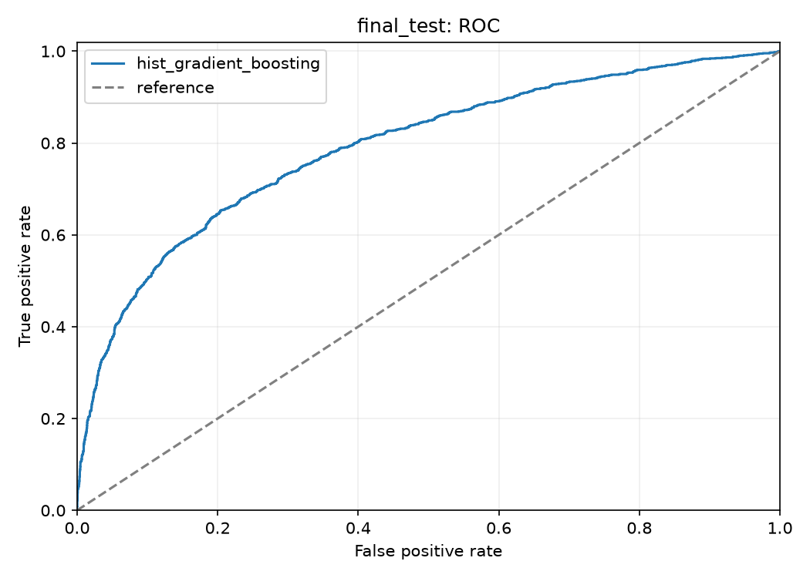
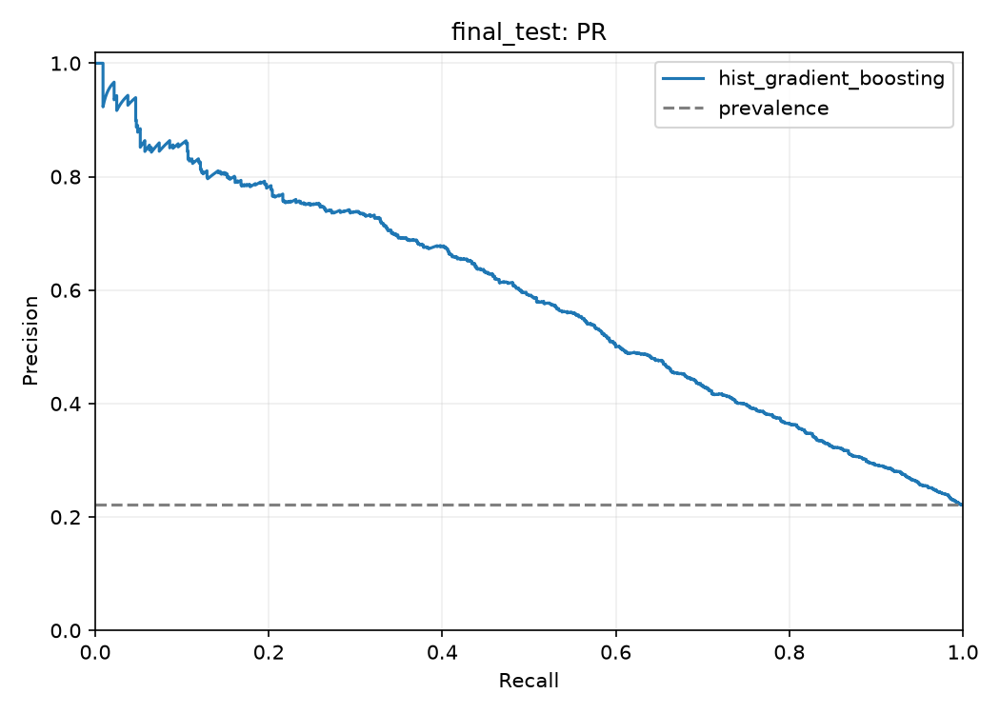
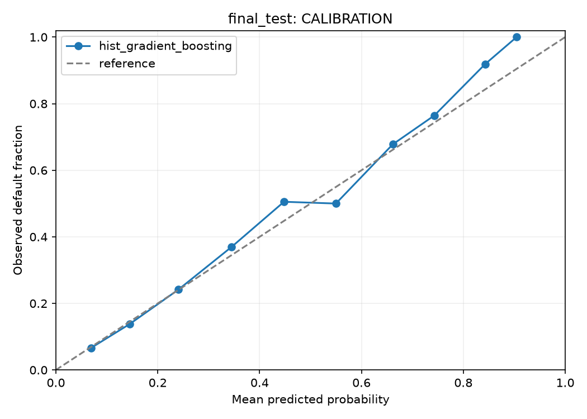

# Final held-out test evaluation

Frozen model: **hist_gradient_boosting**; test clients: 6,000.
No fitting, hyperparameter selection or threshold adjustment on test.

| Model | Threshold | ROC-AUC | AP | Precision | Recall | F1 | Brier | TN | FP | FN | TP |
|---|---:|---:|---:|---:|---:|---:|---:|---:|---:|---:|---:|
| hist_gradient_boosting | 0.261017 | 0.790371 | 0.580091 | 0.520320 | 0.588546 | 0.552334 | 0.131477 | 3953 | 720 | 546 | 781 |

Threshold was fixed on validation. This is a single independent holdout evaluation of the chosen pipeline.
The pipeline remains trained on train only. Do not use these results to reselect or retune on this test set.
Calibration is descriptive; historical data limit generalization. Not for real lending decisions.

